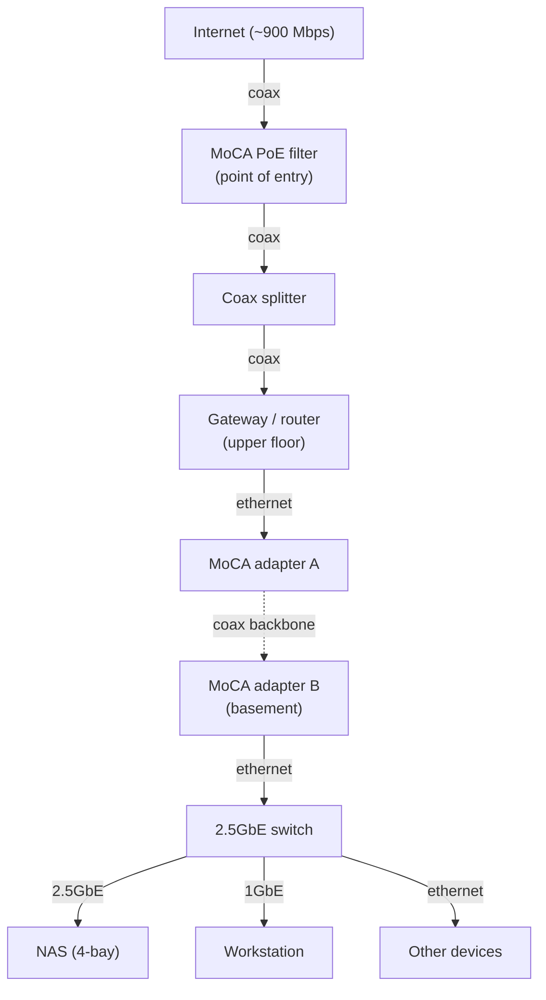

# Homelab & NAS


Self-hosted storage and services on a 4-bay NAS in a basement home lab, with a
wired backhaul over existing coaxial cabling (MoCA). Built to consolidate cloud
and local storage into one redundant pool, run containerized services, and
practice infrastructure and operational security.

Status: build in progress. Hardware selected, documentation and service stacks
being rolled out. Items marked `<placeholder>` or TBD are not yet finalized.

## Table of contents

- [Goals](#goals)
- [Architecture](#architecture)
- [Hardware](#hardware)
- [Network](#network)
- [Services](#services)
- [Security and operations](#security-and-operations)
- [Decisions (ADRs)](#decisions-adrs)
- [What I learned](#what-i-learned)
- [Roadmap](#roadmap)
- [Repository layout](#repository-layout)

## Goals

- Consolidate storage: migrate cloud files and legacy external drives into one redundant pool.
- Reliable backups following a 3-2-1 strategy for irreplaceable data (photos first).
- Run containerized services (media, photos, home automation) on low-power hardware.
- Practice operational security: minimal exposure, secrets hygiene, remote access with no open ports.

## Architecture



Details: [`docs/architecture.md`](docs/architecture.md), [`docs/network.md`](docs/network.md).

## Hardware

| Component | Selected model | Notes |
|-----------|----------------|-------|
| NAS | UGREEN NASync DXP4800 Plus | 4-bay, Intel Pentium Gold 8505, 8 GB DDR5, 10GbE + 2.5GbE, Docker + VM |
| Drives | `<count> x <size>` NAS-rated CMR (WD Red Plus / Seagate IronWolf) | redundant pool, sizes TBD |
| Switch | TP-Link TL-SG108S-M2 | 8-port 2.5GbE, unmanaged, fanless |
| MoCA adapters | ASUS MA-25 x2 | MoCA 2.5, Ethernet-over-coax backhaul |
| PoE filter | MoCA point-of-entry filter | keeps MoCA signal in-house |
| Workstation | Mac mini M4 | NAS client |

Full inventory: [`docs/hardware.md`](docs/hardware.md).

## Network

Wired backhaul runs over the home's existing coaxial wiring using MoCA, so no
new Ethernet was pulled between floors. A PoE filter at the point of entry keeps
the MoCA signal inside the house. Local NAS <-> workstation traffic stays inside
the basement 2.5GbE switch and never crosses the MoCA link. Full topology,
rationale and troubleshooting: [`docs/network.md`](docs/network.md).

## Services

Containerized with Docker. Each stack has a sanitized `docker-compose.example.yml`
and an `.env.example`. Real `.env` files are gitignored.

| Stack | Purpose | Exposure |
|-------|---------|----------|
| immich | Self-hosted photo library (iCloud/Google Photos alternative) | LAN / overlay only |
| media | Media library and streaming (Jellyfin) | LAN / overlay only |
| home-assistant | Home automation, with a HomeKit bridge for non-HomeKit devices | LAN / overlay only |

Planned next: Pi-hole / AdGuard Home, Vaultwarden, Paperless-ngx. See
[`docs/services.md`](docs/services.md).

## Security and operations

- No inbound ports forwarded. Remote access over a private overlay network (Tailscale).
- Secrets kept out of git: `.env` files ignored, `.env.example` templates committed.
- Pre-commit secret scanning (gitleaks), enforced again in CI on every push.
- 2FA on the NAS admin account; automatic ban after failed logins.
- Backups: 3-2-1 (local redundant pool + offsite encrypted copy + cold copy), restores tested.

Details: [`docs/security.md`](docs/security.md), [`docs/backups.md`](docs/backups.md).

## Decisions (ADRs)

Short records of the engineering tradeoffs behind this build:

- [ADR-0001](docs/adr/0001-prebuilt-nas-over-diy.md): prebuilt x86 NAS over a DIY build
- [ADR-0002](docs/adr/0002-moca-over-ethernet-run.md): MoCA backhaul over pulling new Ethernet
- [ADR-0003](docs/adr/0003-moca-speed-tier.md): MoCA speed tier vs the internet ceiling
- [ADR-0004](docs/adr/0004-switch-2-5gbe.md): 2.5GbE switch in the lab

## What I learned

- Internet speed and local network speed are separate budgets: a 900 Mbps WAN does not cap NAS <-> workstation transfers, which stay on the local switch.
- A multi-gig link only helps when both ends and the path support it; otherwise you pay for unused headroom.
- `<an incident you diagnosed and fixed>`

## Roadmap

- [ ] Finalize drive sizing and build the redundant pool
- [ ] Migrate photo library to Immich, validate, then retire cloud photos
- [ ] Add monitoring and alerting
- [ ] Document a restore runbook and test it

## Repository layout

```
.
├── README.md
├── LICENSE
├── setup.sh                  One-command repo create + push (uses gh CLI)
├── hooks/pre-commit          Secret-scan hook (installed by setup.sh)
├── .github/workflows/ci.yml  Secret scan + markdown lint on push
├── docs/
│   ├── architecture.md
│   ├── hardware.md
│   ├── network.md
│   ├── security.md
│   ├── backups.md
│   ├── services.md
│   └── adr/                  Architecture Decision Records
├── services/                 Sanitized docker-compose stacks
│   ├── immich/
│   ├── media-stack/
│   └── home-assistant/
├── scripts/                  Backup and health-check scripts
└── assets/                   Diagrams and screenshots
```

## License

Code under MIT ([`LICENSE`](LICENSE)). Documentation under CC BY 4.0 unless noted.
