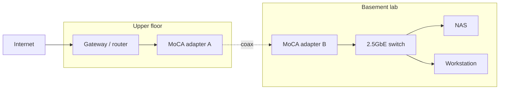

# Architecture

## Overview

A single 4-bay x86 NAS is the core of the lab. It provides a redundant storage
pool and runs containerized services via Docker, with the option of a VM for
home automation. The NAS sits in a basement bedroom and reaches the household
gateway (on an upper floor) over a MoCA link that rides the existing coaxial
cabling. A 2.5GbE switch in the basement fans out to the NAS, the workstation,
and future devices.

## Logical view

## Why this shape

- The gateway must stay upstairs for whole-home coverage, so the lab needs a backhaul to the basement.
- Pulling Ethernet through finished floors was impractical; coax already reaches the room. MoCA reuses it. See [ADR-0002](adr/0002-moca-over-ethernet-run.md).
- A prebuilt x86 NAS gives turnkey backup software plus Docker and VM support, balancing data safety with room to tinker. See [ADR-0001](adr/0001-prebuilt-nas-over-diy.md).

## Data flows

- Cloud sync: cloud storage is pulled into the NAS pool on a schedule.
- Photos: phone and workstation upload to a self-hosted library on the NAS.
- Backups: the pool is copied offsite (encrypted) and to a periodic cold drive.
- Remote access: reaching services from outside the home goes over a private overlay network, never through forwarded ports.
