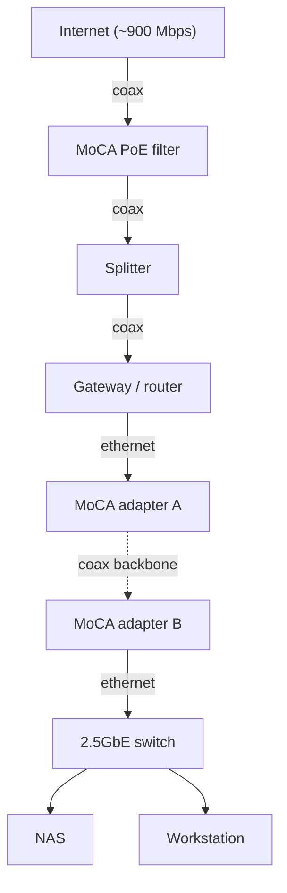

# Network

## Problem

The internet gateway lives on an upper floor so the whole house has coverage.
The lab is in a basement bedroom that has a coaxial wall outlet but no Ethernet
drop. The goal was a reliable, low-latency wired link to the basement without
pulling new cable through finished floors.

## Solution: MoCA backhaul

MoCA (Multimedia over Coax) carries Ethernet over the existing coaxial wiring on
a frequency band above the cable-internet (DOCSIS) band, so the two coexist on
the same cable.

- Adapter A (upstairs): gateway LAN port -> Ethernet -> adapter -> coax (via a splitter shared with the modem).
- Adapter B (basement): wall coax -> adapter -> Ethernet -> switch.
- A PoE filter at the point of entry keeps the MoCA signal inside the house and improves signal quality.

The two adapters form the MoCA link automatically once powered on the same
coax; a link LED on each confirms the connection.

## Topology

## Addressing

Private LAN addressing only (RFC 1918). The NAS uses a DHCP reservation so its
address is stable. Values below use documentation placeholders; never commit a
real public IP.

| Device | Role | Address (example) |
|--------|------|-------------------|
| Gateway | Router / DHCP | 192.168.0.1 |
| NAS | Storage / services | 192.168.0.10 (reserved) |
| Switch | Unmanaged | n/a |

## Design notes

- Local traffic between workstation and NAS stays inside the basement switch and never crosses the MoCA link, so switch speed (2.5GbE) governs those transfers while the MoCA link mainly carries internet (~900 Mbps).
- MoCA 2.5 vs 2.0 was evaluated against the internet ceiling. See [ADR-0003](adr/0003-moca-speed-tier.md).

## Troubleshooting notes

- If MoCA does not link, the usual cause is an old splitter that attenuates the MoCA band; use a splitter rated to at least 1675 MHz.
- The gateway is DOCSIS 3.1, so a band switch on the adapters avoids frequency overlap.
- Entry format: date, symptom, root cause, fix. None logged yet.
